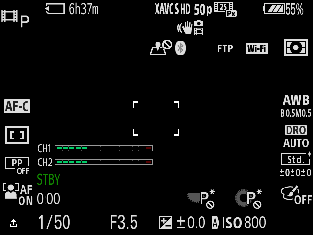
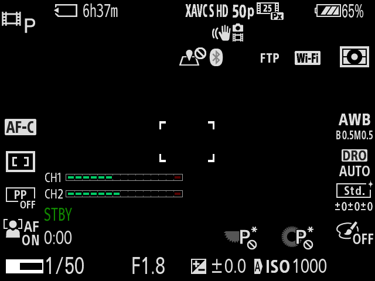

[中文](README.md) | **English**

# A7C Auto Upload

Adds **automatic Wi-Fi video upload** to the first-generation Sony A7C.

When you finish recording, the camera uploads the video over your home Wi-Fi to a regular FTP server and shows the upload progress on screen.
Only videos are uploaded by default; **JPEG / RAW (ARW) photo upload** can be turned on as well. Once installed, no computer or phone needs to stay running, and no dedicated NAS receiver is required.

**Tested: Sony A7C / ILCE-7C, firmware 2.00. Other firmware versions are untested.**

## What it solves

| Stock limitation | This project |
| --- | --- |
| **Stock FTP cannot upload videos**: the camera's built-in FTP transfer only supports photos; videos have to be copied off the card or over a cable. | An independent uploader runs inside the camera and sends each video to FTP automatically after recording, with on-screen progress. Failed uploads are retried and the originals stay on the card. |
| **PC Remote and FTP cannot be on together**: the stock "FTP Function" and "PC Remote" are mutually exclusive, so you cannot remote-control the camera from a computer or phone while it uploads. | Uploads do not depend on the stock FTP switch. With "PC Remote = On" and "stock FTP Function = Off", videos still upload automatically; photos can optionally be uploaded by this project too. |

Computer and phone remote control both use the stock PC Remote over a "Wi-Fi Access Point" connection (camera and computer/phone on the same home router). While remote-controlling: uploads pause during an active remote session (live view) and resume automatically when it ends. With stock FTP turned off, the camera may take a few minutes to rejoin Wi-Fi after disconnecting; files shot meanwhile are uploaded once it reconnects.

## For humans

**The GUI installer is recommended.** Download the package for your computer from [Releases](https://github.com/ProductivityToys/a7c-auto-upload/releases):

| Computer | Package | How to open |
| --- | --- | --- |
| macOS · Apple Silicon | `*-macos-arm64.dmg` | Drag the app into Applications, then open it |
| Windows · x64 | `*-windows-x64.zip` | Extract everything, then open 「A7C 自动上传.exe」 |

The GUI bundles its own runtime; no Python installation is needed. The app interface is currently in Chinese; the labels below are quoted as they appear.


Installer main window (demo data).

### Getting started

First set up your home Wi-Fi on the camera, and prepare a working regular FTP account and upload directory.
The stock FTP Function does not need to be on. To remote-control from a computer or phone, turn on the stock PC Remote and choose a "Wi-Fi Access Point" connection (camera and computer/phone on the same home router).

1. **Connect the camera**: set USB Connection to "Mass Storage", connect it to the computer, and click 「连接相机」 (Connect camera) in the app.
2. **Enter FTP details**: server, account, password and directory, then click 「测试连接」 (Test connection).
3. **Install and start**: tick 「同时上传图片（JPEG 和 RAW）」 (also upload JPEG and RAW) if you want photos, then click 「安装到相机」 (Install to camera). When it shows 「安装成功 · 服务正常」 (installed · service healthy), unplug USB and start shooting.

From then on just shoot as usual: a small mark in the lower-left corner means the service is running; during an upload it turns into a progress bar and returns to the mark when done.
Existing videos are back-filled and new videos are uploaded automatically; with photos enabled, existing and new JPEG / ARW files are handled too. Originals stay on the card and failed uploads are retried.
When this project uploads photos, avoid also enabling the stock automatic photo transfer.

| Service-running mark | Upload progress bar |
| :---: | :---: |
|  |  |

Screenshots of the camera's OSD layer: the mark and progress bar sit in the lower-left corner; the black area does not include the live view.

An existing installation is read automatically; when updating, leave the password empty to keep the saved one. To uninstall, connect the camera and click **「卸载相机服务」 (Uninstall camera service)** on the main window.

[Detailed install, update and recovery guides (Chinese) →](docs/README.md)

## For AI

**The CLI is recommended.** Real-device install and uninstall have been verified on macOS and Windows. Copy the following to your AI assistant:

```text
Please install and configure A7C Auto Upload for me.
Project: https://github.com/ProductivityToys/a7c-auto-upload

It lets a first-generation Sony A7C / ILCE-7C upload videos automatically over home Wi-Fi to a regular FTP server, with optional JPEG / ARW upload.
The camera's stock FTP Function does not need to be on; it works alongside the stock PC Remote (Wi-Fi Access Point mode, from a computer or phone).
Read docs/README.md and docs/cli-guide.md in the repository first (they are in Chinese), and prefer the CLI from the latest scripts package.
Read the camera model, firmware and existing installation state first, then install or update as needed.
Ask me for any missing FTP details; passwords must go through hidden input, never ask me to send one in chat.
Firmware 2.00 is tested; other versions are untested, and compatibility is decided by the installer's own checks.

From the scripts package root: sh start.sh <action>
On Windows: powershell -NoProfile -ExecutionPolicy Bypass -File .\app\install.ps1 <action>
With an existing configuration use install --reuse --yes; with the current version already installed use start.
Photos are off by default; add --photos to enable or --no-photos to disable; when updating without either flag the existing choice is kept.

After installing, check service_started, health.state and requires_power_cycle before telling me it is ready.
Do not report success from exit code 0 alone. Only ask me to act when cabling, authorization or secure input is needed.
```

[CLI commands, return values and technical docs (Chinese) →](docs/README.md)
