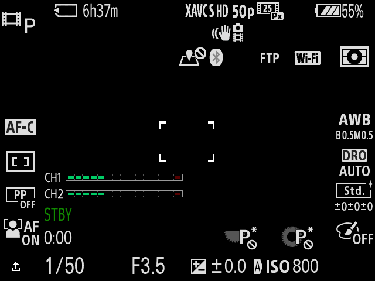
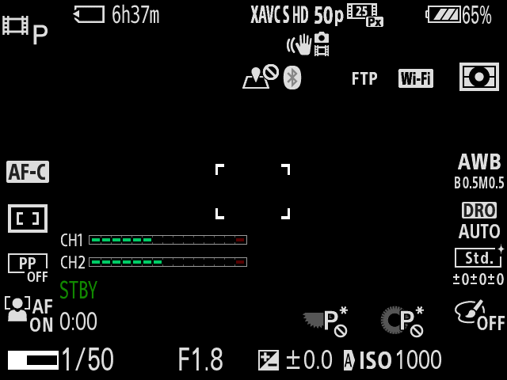

**中文** | [English](README.en.md)

# A7C Auto Upload

给第一代 Sony A7C 补上 **Wi-Fi 视频自动上传**。

录完视频，相机通过家中 Wi-Fi 自动上传到普通 FTP 服务器，屏幕上显示上传进度。
默认只上传视频；也可开启 **JPEG／RAW（ARW）图片上传**。安装后不需要电脑或手机常驻，也不需要 NAS 专用接收程序。

**已验证：Sony A7C / ILCE-7C，固件 2.00。其他固件版本未测试。**

> **免责声明**：本项目是独立开发的非官方开源工具，与 Sony／索尼无隶属关系，未获其认可或支持。软件按“现状”提供，担保与责任限制见 [MIT License](LICENSE)。
>
> 安装会修改相机的启动与运行环境，可能造成相机异常、数据丢失或功能不兼容。请自行评估使用风险，提前备份重要素材，并先在非关键拍摄场景中验证。

## 解决什么问题

| 原厂限制 | 本程序 |
| --- | --- |
| **原厂 FTP 传不了视频**：相机自带的 FTP 传输只支持照片，录好的视频只能插卡或接线拷出。 | 在相机内运行独立的上传程序，录完视频自动传到 FTP，屏幕显示进度；断网会重试，卡上原文件保留。 |
| **开了电脑遥控就不能开 FTP**：原厂「FTP 功能」和「电脑遥控」互斥，想边用电脑或手机遥控边自动上传，原厂做不到。 | 上传不依赖原厂 FTP 开关。保持「电脑遥控＝开」「原厂 FTP 功能＝关」也能自动上传视频；照片可选由本程序一并上传。 |

电脑和手机遥控都走原厂「电脑遥控」的「Wi-Fi 接入点」连接（相机和电脑／手机连同一个家庭路由器）。同时遥控时：遥控会话（实时取景）进行期间上传会暂缓，结束会话后自动继续；原厂 FTP 关闭后，相机断开 Wi-Fi 再重连可能需要几分钟，期间的文件会在连上后补传。

## For humans / 给人类看

**推荐使用 GUI 安装器。** 从 [Releases](https://github.com/ProductivityToys/a7c-auto-upload/releases) 下载对应平台的安装包：

| 电脑 | 安装包 | 打开方式 |
| --- | --- | --- |
| macOS · Apple Silicon | `*-macos-arm64.dmg` | 把 App 拖入「应用程序」后打开 |
| Windows · x64 | `*-windows-x64.zip` | 完整解压，打开「A7C 自动上传.exe」 |

GUI 自带运行环境，不需要安装 Python。


安装器主界面（演示数据）。

### 开始使用

先在相机中配置家中 Wi-Fi，并准备一个可用的普通 FTP 账号和上传目录。
相机需用以下一种已验证的方式保持联网：

- 保持原厂「FTP 功能＝开」。
- 若关闭原厂 FTP，则开启「电脑遥控」，连接方式选「Wi-Fi 接入点」（相机与电脑／手机连接同一个家庭路由器）。上传时断开遥控软件的实时取景会话。

本程序使用相机现有的网络连接，不会主动开启 Wi-Fi；只保存 Wi-Fi 接入点配置并不等于已经联网。

1. **连接相机**：USB 选「海量存储器」，连接电脑，在 App 点「连接相机」。
2. **填写 FTP**：输入服务器、账号、密码和目录，点「测试连接」。
3. **安装并启动**：按需勾选「同时上传图片（JPEG 和 RAW）」，点「安装到相机」。等到「安装成功 · 服务正常」，拔掉 USB 即可使用。

之后正常拍摄视频即可：左下角小标记表示服务运行中，上传时变成进度条，完成后恢复小标记。
程序会补传旧视频、自动上传新增视频；开启图片后，也会补传已有和新增 JPEG／ARW。卡上原文件保留，断网后重试。
开启图片上传后，默认勾选「原厂 FTP 开启时，暂停本服务的照片上传」：原厂 FTP 开启时，照片交给原厂；关闭后，本服务继续补传卡上的照片。视频上传始终保留。

| 服务运行标记 | 上传进度条 |
| :---: | :---: |
|  |  |

相机实机 OSD 层截图：标记与进度条在左下角，黑色区域不包含取景画面。

已有安装会自动读取配置；更新时密码留空即可沿用。需要卸载时，连接相机，在主界面点 **「卸载相机服务」**。

[详细安装、更新与恢复说明 →](docs/README.md)

## For AI / 给 AI 看

**推荐使用 CLI。** macOS、Windows 的实机安装和卸载已验证。把下面这段复制给你的 AI 助手：

```text
请帮我安装并配置 A7C Auto Upload。
项目：https://github.com/ProductivityToys/a7c-auto-upload

它让第一代 Sony A7C / ILCE-7C 通过家庭 Wi-Fi 自动上传视频到普通 FTP，也可选传 JPEG／ARW。
相机需保持联网：原厂「FTP 功能＝开」；或关闭原厂 FTP、开启「电脑遥控」，选择「Wi-Fi 接入点」连接家庭路由器。
本程序不会主动开启 Wi-Fi。遥控软件的实时取景会话期间上传暂缓，断开会话后继续；无需电脑或手机常驻。
请先阅读仓库 docs/README.md 与 docs/cli-guide.md，优先使用最新脚本包的 CLI。
先读取相机型号、固件和已有安装状态，再按需安装或更新。
缺少的 FTP 信息向我询问；密码通过隐藏输入处理，不要让我在聊天中发送。
固件 2.00 已验证，其他版本未测试，兼容性以当前安装器检测结果为准。

脚本包根目录使用：sh start.sh <action>
Windows 使用：powershell -NoProfile -ExecutionPolicy Bypass -File .\app\install.ps1 <action>
已有配置可用 install --reuse --yes；已有当前版本可用 start。
图片默认关闭；需要时加 --photos，关闭用 --no-photos；更新时未指定则保留已有选择。
原厂 FTP 开启时暂停照片上传的选项默认开启；如需关闭，加 --no-pause-photos-for-native-ftp，之后更新会保留该选择。

安装后检查 service_started、health.state 和 requires_power_cycle，再告诉我是否已可使用。
不要只根据退出码 0 报成功。只有需要接线、授权或安全输入时再请我操作。
```

[CLI 命令、返回值与技术文档 →](docs/README.md)

## 许可

本项目原创代码采用 [MIT License](LICENSE)。第三方组件保留各自许可，见[第三方组件](installer/THIRD_PARTY.md)。
